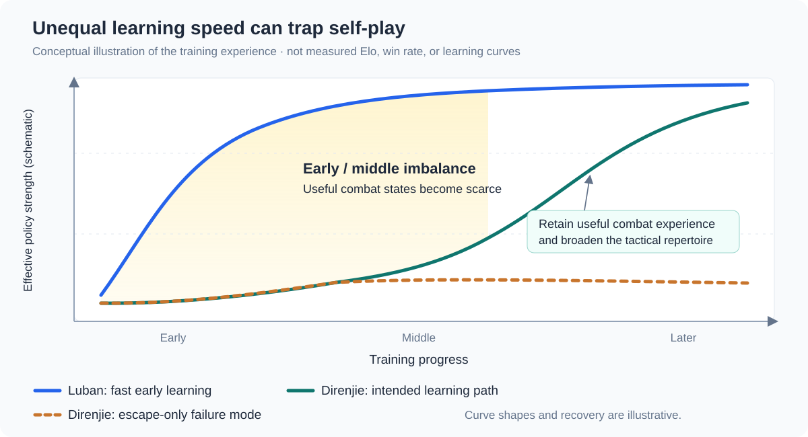
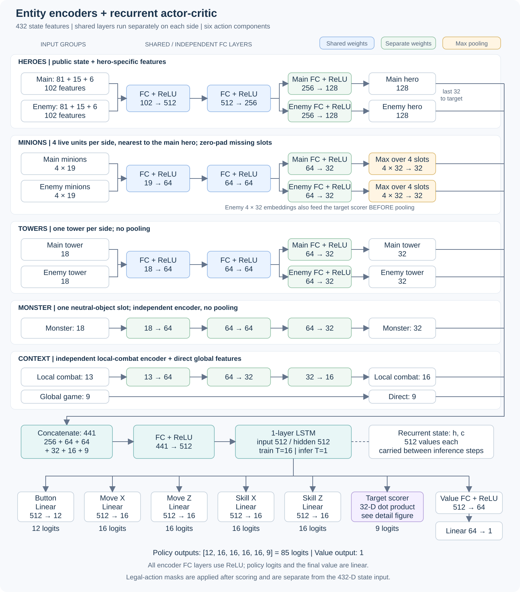
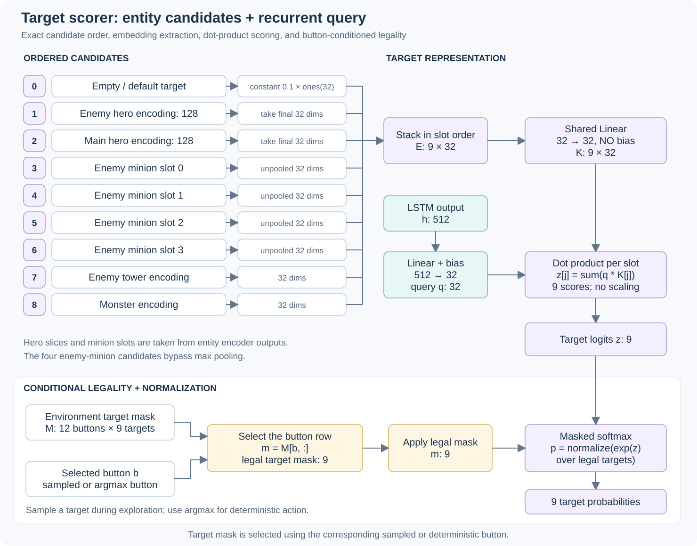

# 5th Place, Southwest Regional Finals — 2026 Tencent Kaiwu AI Competition

**Honor of Kings 1v1 · Self-Play Reinforcement Learning · Solution Writeup**

This repository contains my solution for the **2026 Tencent Kaiwu AI Competition Regional Finals**, where I placed **5th in the Southwest region**. The task is *Honor of Kings 1v1* (王者荣耀 1v1), with **Luban No. 7 (鲁班七号)** and **Di Renjie (狄仁杰)** as the available heroes.

Thank you to the competition organizers for providing the game environment, training framework, and competition platform.

> **Repository scope:** this is an archived agent implementation and solution writeup. It requires the **official Tencent Kaiwu competition Docker environment**, including the game runtime, agent interfaces, and distributed training services. It cannot run as a standalone Python project. The repository includes an archived checkpoint under `ckpt/`; that checkpoint also requires the compatible competition environment.

## Overview

The solution combines a recurrent PPO policy with task-specific features, tactical reward shaping, and quality-aware self-play sampling:

- **Structured entity features** describe the heroes, minions, towers, neutral monster, projectiles, skill states, and map timers.
- **Entity encoders and an LSTM** combine the current combat situation with temporal context. Six action branches control the action button, movement, skill offsets, and target selection.
- **Self-play across all four hero pairings** trains a shared policy for both heroes and both sides of the matchup.
- **Episode-level quality filtering and bucket balancing** control which experiences reach PPO, especially when Di Renjie is heavily suppressed by Luban early in training.
- **A tactical reward curriculum** first encourages useful combat skills, then reduces auxiliary incentives so the policy can prioritize winning the match.

The central training problem was unequal learning speed: **a stronger self-play opponent can improve so quickly that the other hero stops encountering the situations needed to learn how to fight back.**

## Competition Task and Evaluation

The game is played on **Mo Jia Ji Guan Dao (墨家机关道)**. Each side controls one hero, earns gold and experience, fights for minion and neutral-monster resources, and attempts to destroy the opposing defensive tower. **Destroying the tower wins the match; destroying the crystal is not required.** The official task description specifies a 20,000-frame timeout, with no win awarded for a timeout or abnormal ending. See the [official competition guide](https://tencentarena.com/docs/p-competition-hok1v1/61.1.4/guidebook/dev-guide/intro/).

The final evaluation covers all four pairings:

| My hero | Opponent hero | Matches |
| --- | --- | ---: |
| Di Renjie | Di Renjie | $n$ |
| Di Renjie | Luban No. 7 | $n$ |
| Luban No. 7 | Di Renjie | $n$ |
| Luban No. 7 | Luban No. 7 | $n$ |

Performance is assessed through cumulative wins across these **$4n$ matches**. A policy therefore needs useful behavior in both mirror matchups and both directions of the mixed matchup. Improving Luban alone leaves a substantial part of the evaluation unresolved.

## The Self-Play Imbalance Problem

### Why Di Renjie Fell Behind Early

In my training runs, Luban's combat strength improved much faster at the beginning. Di Renjie took longer to acquire the combinations of movement, positioning, and skill timing needed to contest him. The mixed matchup could become extremely one-sided; **a 0:20-style scoreline illustrates the severity of the imbalance**, rather than a measured aggregate win rate.

The heroes' mechanics help explain this difference in learning difficulty. Luban's passive converts the fifth normal attack, or the next normal attack after a skill, into a three-hit barrage. A comparatively simple attack-and-skill pattern can therefore discover useful damage output early. His second skill also provides knockback and damage against an already injured opponent.

Di Renjie has movement and attack-speed stacks, a second skill that removes negative effects and briefly grants invulnerability, and a directional ultimate that stuns and reduces defenses. Exploiting these tools requires more coordinated decisions: maintaining attack rhythm, choosing when to disengage, timing defensive skills, landing the ultimate, and following up during the resulting opportunity. The mechanics are described in the [official hero information](https://tencentarena.com/docs/p-competition-hok1v1/61.1.4/guidebook/dev-guide/intro/#%E8%8B%B1%E9%9B%84%E4%BF%A1%E6%81%AF). The connection to learning speed is my interpretation of the observed training behavior, rather than a claim that Di Renjie is inherently unwinnable against Luban.



*This is a schematic explanation, not a plot of recorded Elo, win rates, or training measurements. The rising Di Renjie path illustrates the intended learning trajectory; the dashed path illustrates the failure mode.*

### How Repeated Losses Became a Local Optimum

The problem was more specific than simply losing games. Severely one-sided rollouts contained little successful retaliation, well-timed skill use, or productive tower defense. Learning predominantly from that experience could produce a Di Renjie policy that **kept running away even under the protection of its own tower**.

That behavior changed the future training data as well:

```text
Early combat disadvantage
        ↓
Repeated one-sided combat experience
        ↓
Retreat becomes the dominant learned response
        ↓
Fewer opportunities to discover useful counterplay
        └──────────────────────────────→ reinforces retreat
```

Escaping can reduce immediate damage while sacrificing farming, tower defense, and opportunities to punish an opponent. Once the policy repeatedly chooses that response, merely collecting more self-play data can reinforce the same behavior.

My response was to **control the contribution of different kinds of experience**, while providing rewards for tactical alternatives to retreat. Losing trajectories were still useful when they contained sustained, competitive interaction; the goal was to prevent rapidly collapsed games from dominating training.

## Feature Construction

The policy receives **432 state features**. The dimensions below agree with both the configuration and the actual concatenation order in the feature processor.

| Feature group | Dimensions | Main information |
| --- | ---: | --- |
| Public hero state, both sides | $81\times2=162$ | Health, mana, level, economy, combat attributes, position, skill readiness and cooldowns, tower relationships, grass, health packs, combat relationships, and Rage timing |
| Defensive towers, both sides | $18\times2=36$ | Position, health, attack range, distances, and attack-target relationships |
| Neutral monster | 18 | Availability, visibility, position, health, rewards, and interaction with both heroes |
| Minions, both sides | $19\times4\times2=152$ | Four minion slots per side, including combat state, geometry, and attack-range relationships |
| Global game context | 9 | Game phase, next minion wave, neutral-monster respawn, and both health-pack timers |
| Luban-specific state, both sides | $15\times2=30$ | Normal-attack stage, ultimate projectile geometry, proximity to the opponent, and estimated remaining ultimate duration |
| Di Renjie-specific state, both sides | $6\times2=12$ | Normal-attack stage and estimated remaining stun duration after an ultimate hit |
| Additional local combat context | 13 | Nearest enemy projectile, skill and attack range relationships, and hero-distance bins |
| **Total** | **432** | |

### Geometry, Normalization, and Entity Slots

Features use configuration-driven **one-hot encodings and clipped min-max normalization**. Relevant coordinates are transformed for the second camp so that the two sides share a consistent directional convention.

Each side contributes the **four living minions nearest to the controlled hero**. Missing slots are zero-padded. The selected enemy-minion slots also define candidate targets for the policy, so their ordering remains consistent between observation construction and action selection.

Public hero features are complemented by hero-specific features. For each hero, the network combines **81 public values, 15 Luban-specific values, and 6 Di Renjie-specific values**, producing a 102-dimensional hero input. Features for the other hero type are zero-filled.

### Making Tactical Opportunities Observable

The additional features express situations that matter for the reward curriculum:

- **Attack stages** expose the heroes' attack cycles instead of requiring the policy to infer every stage from unrelated state changes.
- **Projectile position and distance** help distinguish danger and skill opportunities that similar hero positions alone cannot describe.
- **Tower attack relationships** distinguish standing near a tower from an opponent actually being targeted by that tower.
- **Grass and combat relationships** provide context for ambushes and re-engagements.
- **Ultimate and summoner-skill timers** provide short-term temporal context. These are estimates maintained from event counters and frame differences, rather than direct access to hidden game state.

Source: [`feature_process/`](agent_ppo/feature/feature_process/), [`DimConfig`](agent_ppo/conf/conf.py).

## Model Architecture

The model architecture was informed by Tencent's Honor of Kings / JueWu (绝悟) research, particularly [*Mastering Complex Control in MOBA Games with Deep Reinforcement Learning*](https://arxiv.org/abs/1912.09729).



### Entity Encoders and Recurrent Fusion

| Branch | Structure |
| --- | --- |
| Heroes | Shared $102\rightarrow512\rightarrow256$ MLP, followed by separate $256\rightarrow128$ projections for the controlled and enemy heroes |
| Minions | Shared $19\rightarrow64\rightarrow64$ MLP per minion, separate $64\rightarrow32$ projections per side, then max pooling over the four minions on each side |
| Towers | Shared $18\rightarrow64\rightarrow64$ MLP, followed by separate $64\rightarrow32$ projections per side |
| Neutral monster | Independent $18\rightarrow64\rightarrow64\rightarrow32$ encoder |
| Additional combat context | $13\rightarrow64\rightarrow32\rightarrow16$ MLP |
| Global context | Nine values passed directly to the fusion stage |
| Fusion | Concatenate to **441 dimensions**, then project $441\rightarrow512$ |
| Temporal model | **One-layer, unidirectional LSTM with 512 hidden units**; 16-step sequences during training, one step with carried state during inference |
| Critic | $512\rightarrow64\rightarrow1$ value head |

Only the minion groups use max pooling. The tower and monster branches each contain a single object slot. Hidden layers use ReLU; policy logits and the final value output are linear. LSTM state resets between games.

### Factorized Actions and Target Scoring

The action is a six-part tuple:

```text
[button, move_x, move_z, skill_x, skill_z, target]
```

The branch sizes are **[12, 16, 16, 16, 16, 9]**, giving 85 policy logits. The first five branches are separate linear heads from the LSTM output. The target branch uses entity-aware dot-product scoring:



The nine target slots are **empty target, enemy hero, controlled hero, four enemy minions, enemy tower, and neutral monster**. Hero candidates use the last 32 dimensions of their 128-dimensional encodings. The minion candidates retain their **individual, unpooled 32-dimensional encodings**. The empty target starts as a constant 0.1 vector.

For candidate embedding $e_i$ and recurrent state $h_t$, the target logits are:

$$
q_t=W_qh_t+b_q,\qquad k_i=W_ke_i,\qquad z_i=q_t^\top k_i,
$$

where $q_t,k_i\in\mathbb{R}^{32}$ and $W_k$ has no bias. This produces nine logits by comparing the current decision context with the available entities.

The environment supplies a **184-dimensional legal-action mask**, including a $12\times9$ button–target legality matrix. After selecting the button, the agent chooses the corresponding nine-element target-mask row and applies masked softmax to the target logits. The training record stores the selected row, reducing its legal-action field to 85 dimensions. **The mask is separate from the 432-dimensional neural-network state input.**

The retained agent also includes a small number of skill-specific aim and target overrides for Di Renjie's ultimate and selected Luban skills. Summoner-skill selection is currently restricted to **Rage (狂暴)**.

Source: [`model.py`](agent_ppo/model/model.py), [`agent.py`](agent_ppo/agent.py), [`definition.py`](agent_ppo/feature/definition.py).

## Reward Design

The reward has two roles: express the objective of winning the match, and make useful intermediate combat behavior discoverable during training.

### Economy, Combat, and Tower Progress

These are the weights in the retained configuration. A weight multiplies an underlying reward value; it is not necessarily the reward for a complete event.

| Reward | Weight | Meaning |
| --- | ---: | --- |
| `money` | 0.008 | Change in the gold advantage over the opponent |
| `exp` | 0.008 | Change in the cumulative experience advantage |
| `hp_point` | 2.0 | Change in the health advantage, using the fourth root of each hero's health fraction |
| `ep_rate` | 0.55 | Change in the controlled hero's mana fraction |
| `kill` | -0.5 | Change in the difference between the two kill counters |
| `death` | -0.8 | Change in the difference between the two death counters |
| `tower_hp_point` | 10.0 | Change in the difference between friendly and enemy tower-health fractions |
| `last_hit` | 0.5 | Positive for a friendly last hit, negative for an enemy last hit |
| `monster_kill` | 0.25 | Positive for a friendly neutral-monster kill, negative for an enemy kill |
| `wave_hit_enemy_hero` | 0.1 | First hit on the enemy hero during each minion-wave period |
| `forward` | 0.01 | Penalizes remaining too far behind the friendly tower while nearly at full health |

The negative `kill` weight should be read together with `death`: an ordinary solo kill contributes **$-0.5+0.8=+0.3$** from these two terms, before time decay and other rewards.

### Learning a Broader Tactical Repertoire

I used tactical shaping to make ambushes, tower-assisted retaliation, ultimate follow-ups, and selective summoner-skill use easier to discover. These give Di Renjie alternatives to indiscriminate retreat.

| Tactical term | Current weight | Implemented event |
| --- | ---: | --- |
| `grass_ambush_kill` | 0.25 | After being in grass and unseen by the opponent, leave that state and secure a kill within 150 frames, approximately 5 seconds |
| `direnjie_ult_hit_under_tower` | 0.15 | Land an ultimate while the friendly tower is targeting the enemy hero |
| `direnjie_ult_kill_after_hit` | 0.25 | Secure a kill within 150 frames after an ultimate hit |
| `direnjie_ult_miss` | 0.05 | Raw value $-1$ if no hit is detected more than 60 frames after release |
| `rage_kill_after_use` | 0.25 | Secure a kill within 240 frames, approximately 8 seconds, after using Rage |
| `rage_use_penalty` | 0.2 | Raw value $-1$ when using Rage |
| `recover_use_penalty` | 0.1 | Raw value $-1$ when using the recovery skill |

The tower-assisted term rewards **retaliation while the tower is attacking the opponent**; the hit itself qualifies, without requiring a kill. The ultimate-follow-up term can then reward converting the opportunity into a kill. Combining these terms encourages a useful sequence rather than simply rewarding survival under the tower.

Tower aggression and dive-related play were also part of my training experiments. The retained source has a specific **tower-edge poke** term: Di Renjie remains outside the enemy tower's range plus a safety margin and lands the ultimate on an opponent inside that range. It describes a safe tower-edge attack, rather than an unconditional bonus for entering enemy-tower range.

Four implemented terms currently have **zero weight**: `monster_first_hit`, `rage_no_kill_after_use`, `direnjie_ult_tower_poke`, and `direnjie_ult_level4_kill`. Thus, the archived configuration has **18 nonzero shaping terms out of 22 configured terms**.

### From Skill Acquisition to Winning

My competition training process used a staged approach: **first make useful skills learnable, then reduce auxiliary reward weights once the policy has acquired them**. The aim was to retain the learned repertoire while moving the optimization emphasis toward the final match outcome. An ambush, a tower counterattack, or a skill combination is valuable because it helps win the game, rather than because it repeatedly triggers an auxiliary bonus.

Experiments showed that **the model retained the corresponding tactical skills even after their reward weights were reduced to zero or close to zero later in training**. Its actual match win rate also improved relative to the stage before the reduction. This supports using tactical rewards to teach reusable skills, then reducing their influence as the policy shifts toward winning the match.

The code supports episode-based linear interpolation of selected reward weights. **In the retained snapshot, reward-weight scheduling is disabled and its schedule dictionary is empty.** The fixed weights above describe the saved configuration; they do not reconstruct the complete sequence of curriculum adjustments used during competition training.

This cross-episode curriculum is distinct from the active **within-game time decay**:

$$
r_t^{\mathrm{dense}}=0.6^{f_t/8000}\sum_i w_i r_{i,t},
$$

where $f_t$ is the game frame number. Earlier economic and combat advantages receive more weight through this factor. The time-scale scheduling option is also disabled in the retained configuration.

At a normal terminal state, the workflow adds **$+2.5$ for a win or $-2.5$ for a loss**, using the remaining tower health to identify the winning side. Tied tower health gives zero, and truncations receive no terminal win/loss reward. This term is added after dense-reward decay. It is an internal training reward; the official evaluation awards wins according to the competition rules above.

Source: [`reward_process.py`](agent_ppo/feature/reward_process.py), [`GameConfig`](agent_ppo/conf/conf.py), [`train_workflow.py`](agent_ppo/workflow/train_workflow.py).

## Self-Play and Sample Quality Control

### Matchup Coverage and Opponent Diversity

The lineup iterator covers **Luban–Luban, Luban–Di Renjie, Di Renjie–Luban, and Di Renjie–Di Renjie**, shuffling the combinations each cycle. In ordinary self-play, both sides load the latest policy and both sides generate training samples.

For non-evaluation mixed-hero games, the retained workflow has a **4% probability of attempting a model-pool opponent**. If eligible model IDs are available, it selects one uniformly for the Luban side. Di Renjie uses the latest policy and supplies training data; the pool-controlled Luban acts only as the opponent. This introduces opponent variety, without assuming that every sampled historical opponent is weaker.

### Quality as an Effective Training Weight

I controlled the influence of different experiences through **episode acceptance and the balance between accepted categories**. In this implementation, a rejected episode contributes no PPO samples; an accepted episode contributes its collected trajectory. This is how low-quality experience is down-weighted or filtered. It is **not a separate per-frame quality multiplier in the PPO loss**.

The ordinary mixed-matchup gate uses the outcome from Di Renjie's perspective and the episode duration:

| Mixed-matchup outcome | Frame count | Category / action |
| --- | ---: | --- |
| Di Renjie wins | Any duration | `good` |
| Di Renjie loses after a long game | $f>8000$ | `good` |
| Di Renjie loses after a medium-length game | $7000<f\le8000$ | `mid_loss` |
| Di Renjie loses quickly | $f\le7000$ | Discard |
| Draw or unknown winner | Any duration | Discard |

Longer losses remain eligible because the policy can still learn from sustained interaction and resistance. A defeat does not automatically mean the trajectory is useless.

After the first eligible episode is accepted, the gate accepts only a bucket different from the **last accepted bucket**. This alternates accepted `good` and `mid_loss` games, giving approximately **1:1 accepted episode counts**, rather than letting whichever category is most frequent dominate. Because games have different lengths, this is not an exact 1:1 balance of frames or LSTM sequences. Mirror matchups bypass this mixed-matchup gate.

Model-pool games use a separate, stricter rule in the current configuration: keep only episodes with a known winner and **at least 10,000 frames**. Shorter pool games are discarded regardless of which hero won. In ordinary self-play the gate accepts or rejects both sides' trajectories together; in pool games only Di Renjie's trajectory is eligible for training.

### Breaking the Retreat Feedback Loop

The sampling rule and the reward curriculum address different parts of the same problem:

1. **Quality filtering reduces the dominance of rapidly collapsed games.** Di Renjie is less heavily trained on the same pattern of immediate suppression and retreat.
2. **Bucket balancing retains more than one kind of useful experience.** Wins and sustained resistance coexist with selected losses.
3. **Tactical rewards make alternative behavior discoverable.** Fighting back under a friendly tower, landing an ultimate, or attacking from concealment can produce a learning signal before it reliably produces match wins.
4. **Reducing auxiliary rewards later restores emphasis to the final objective.** The learned skills become tools for winning rather than ends in themselves.

Outcome and duration are practical proxies for trajectory quality. They do not prove that every retained transition is useful, and the thresholds reflect this training setup. The repository does not include controlled ablations quantifying the contribution of each rule.

Source: [`lineup_iterator`](agent_ppo/feature/definition.py), [`episode selection and opponent loading`](agent_ppo/workflow/train_workflow.py).

## PPO Training

The recurrent actor–critic is trained with **branchwise clipped PPO**, value regression, and entropy regularization. Advantages use Generalized Advantage Estimation:

$$
\delta_t=r_{t+1}+\gamma V_{t+1}-V_t,\qquad
\hat A_t=\delta_t+\gamma\lambda\hat A_{t+1},\qquad
\hat R_t=\hat A_t+V_t.
$$

| Setting | Retained configuration |
| --- | --- |
| Discount $\gamma$ | 0.997; gamma scheduling disabled |
| GAE $\lambda$ | 0.95 |
| LSTM sequence length / hidden size | 16 / 512 |
| PPO clip | 0.2 |
| Optimizer | Adam, $\beta=(0.9,0.999)$, $\epsilon=10^{-8}$ |
| Learning-rate base / target | $10^{-4}$ / $10^{-5}$ |
| Learning-rate schedule | Zero multiplier through scheduler step 200; then the configured linear decay reaches the target at step 6000 |
| Entropy coefficient | Linear decay from 0.025 to 0.0025 over 6000 learner updates |
| Gradient-norm clipping | 0.5 |
| Replay configuration | Capacity 5000, uniform sampling, FIFO removal |
| Learner batch size | 1024 |
| Replay sample-to-insert ratio | 2 |

The policy and entropy losses use action-subbranch masks and frame training flags. Those masks express which action components are trainable for a transition; they are distinct from the episode-quality gate. Sample delivery and distributed execution are managed by the Kaiwu framework.

Source: [`algorithm.py`](agent_ppo/algorithm/algorithm.py), [`model loss`](agent_ppo/model/model.py), [`sample processing and GAE`](agent_ppo/feature/definition.py), [`training configuration`](conf/configure_app.toml).

## Code Guide and Runtime Requirements

```text
agent_ppo/
├── agent.py                      # Inference, action masks, skill selection, model interfaces
├── algorithm/algorithm.py        # Optimizer, entropy schedule, gradient clipping
├── conf/conf.py                  # Feature dimensions, reward weights, PPO parameters
├── conf/train_env_conf.toml      # Self-play and evaluation settings
├── feature/feature_process/      # Entity features, normalization, hero-specific state
├── feature/reward_process.py     # Dense rewards and cross-frame tactical events
├── feature/definition.py         # Lineup iteration, trajectories, GAE, LSTM sequences
├── model/model.py                # Entity encoders, LSTM, policy/value heads, PPO loss
└── workflow/train_workflow.py    # Rollouts, opponent selection, episode-quality gates
conf/                            # Kaiwu application and distributed training configuration
ckpt/                            # Archived model checkpoint and associated metadata
assets/                          # Architecture and conceptual training diagrams
```

Running the agent requires the competition-provided modules and services, including **`kaiwudrl`**, **`tools`**, the Honor of Kings game runtime, and the training infrastructure. PyTorch and NumPy are also used, but installing those packages alone does not supply the game or platform integration.

The checkpoint metadata identifies the **61.1.4** competition project environment. Training or evaluation should use the corresponding official Docker setup and entry points. This repository does not provide a standalone local-game launcher.

## Result and Scope

The reported result is **5th place in the Southwest region of the 2026 Regional Finals**. The contribution of this writeup is the complete solution approach: entity-aware recurrent control, tactical skill acquisition, and management of the self-play data distribution when the two heroes learn at different speeds.

The learning-speed discussion reflects my competition training experience. The diagrams are explanatory, and the configuration tables describe the retained source snapshot. They should not be interpreted as a reconstructed training log or as measured ablation results.

## References

- [Tencent Kaiwu — Honor of Kings 1v1 competition guide, version 61.1.4](https://tencentarena.com/docs/p-competition-hok1v1/61.1.4/guidebook/dev-guide/intro/).
- Ye et al. [Mastering Complex Control in MOBA Games with Deep Reinforcement Learning](https://arxiv.org/abs/1912.09729), AAAI 2020.
- Schulman et al. [Proximal Policy Optimization Algorithms](https://arxiv.org/abs/1707.06347), 2017.
- Schulman et al. [High-Dimensional Continuous Control Using Generalized Advantage Estimation](https://arxiv.org/abs/1506.02438), ICLR 2016.
